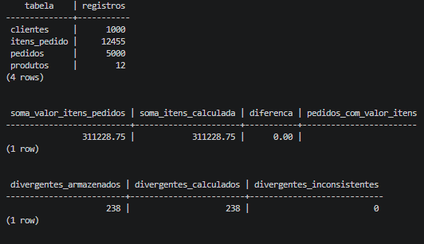

# ETL Verdejar

Pipeline em Python que extrai clientes e pedidos da API Verdejar, transforma os
dados brutos e os carrega no PostgreSQL usando
`insumos_verdejar/schema.sql`.

## Visão geral das partes

| Parte | Etapa | O que demonstra |
|---|---|---|
| **1** | Extração | Paginação da API, leitura do CSV e preservação dos dados brutos |
| **2** | Transformação | Regras A1–A6, contadores e contrato coerente com o esquema |
| **3** | Carga | Inserção PostgreSQL, idempotência e reconciliação |
| **4** | Testes e validação | Testes automatizados e consultas executadas no PostgreSQL |
| **5** | Entrega e documentação | Registro do uso de IA, histórico dos PRs e evidências finais |

## Preparação

1. Instale as dependências:

   ```powershell
   python -m pip install -r requirements.txt
   ```

2. Crie o banco `verdejar` e aplique o esquema uma vez:

   ```powershell
   & "C:\Program Files\PostgreSQL\18\bin\psql.exe" -h localhost -p 5432 -U postgres -d verdejar -W -f .\insumos_verdejar\schema.sql
   ```

   No Windows, ajuste o número `18` para a versão instalada do PostgreSQL.
   A opção `-W` solicita a senha no terminal.

3. Configure a senha do PostgreSQL como variável de ambiente `PGPASSWORD` no
   terminal em que executará o ETL. Não coloque a senha no código nem a versione.
   O arquivo `.gitignore` já exclui arquivos `.env`.

   As demais variáveis de conexão são opcionais:

   | Variável | Padrão |
   |---|---|
   | `PGHOST` | `localhost` |
   | `PGPORT` | `5432` |
   | `PGDATABASE` | `verdejar` |
   | `PGUSER` | `postgres` |
   | `PGPASSWORD` | Sem padrão; forneça no ambiente |

4. Em um terminal, inicie a API:

   ```powershell
   python .\insumos_verdejar\api_verdejar.py --dados .\insumos_verdejar\dados
   ```

Mantenha esse terminal aberto. Antes de executar o ETL, confirme a API em outro
terminal:

```powershell
Invoke-RestMethod "http://127.0.0.1:8000/saude"
Invoke-RestMethod "http://127.0.0.1:8000/pedidos?page=1&page_size=100" |
    Select-Object page, total_pages
```

## Executar o pipeline

Com a API em execução e as variáveis do PostgreSQL configuradas:

```powershell
python -m etl.main
```

O fluxo executa extração, transformação, carga e reconciliação. Os registros
brutos permanecem em `brutos/`.

## Parte 1 — Extração e dados brutos

`etl/extracao.py` percorre todas as páginas das rotas `/clientes` e `/pedidos`,
lê `produtos.csv` com `csv.DictReader` e UTF-8 e salva os três conjuntos em
`brutos/` antes da transformação. Os arquivos brutos são ignorados pelo Git
para não versionar dados pessoais.

## Parte 2 — Transformação e contrato

`etl/transformacao.py` aplica A1–A6 sem alterar os registros de entrada.
`CONTRATO_DE_DADOS.md` descreve as quatro tabelas e as regras de origem e
destino. O contador `valores_convertidos` inclui valores monetários recebidos
como texto; os que já chegam numéricos são normalizados para duas casas, mas
não entram nesse contador.

## Parte 3 — Carga, idempotência e reconciliação

Cada carga executa `TRUNCATE TABLE itens_pedido, pedidos, clientes, produtos
RESTART IDENTITY` e as inserções na mesma transação PostgreSQL. Os dados são
inseridos na ordem `produtos`, `clientes`, `pedidos`, `itens_pedido`. Se uma
inserção ou a consulta de reconciliação falhar com uma exceção, a transação
inteira é revertida. Após o commit, qualquer diferença entre origem e destino
é reportada e faz o orquestrador terminar com código diferente de zero; uma
execução reconciliada substitui integralmente a carga anterior.

**Atenção:** essa estratégia apaga e substitui todos os registros dessas quatro
tabelas. Use o banco `verdejar` dedicado ao exercício.

Para validar a idempotência, execute `python -m etl.main` duas vezes seguidas
com a mesma origem. As contagens carregadas e os totais reconciliados devem ser
iguais nas duas execuções. A saída é texto simples, com contagens por tabela,
soma de `valor_itens` na origem e no destino, diferença e total de pedidos
divergentes.

## Parte 4 — Testes e validação no PostgreSQL

Execute os testes automatizados sem precisar de um banco PostgreSQL:

```powershell
python -m pytest
```

Resultado verificado após os ajustes: **14 passed**.

Para conferir as contagens, a soma de `valor_itens` e a regra do campo
`divergente` no banco carregado:

```powershell
& "C:\Program Files\PostgreSQL\18\bin\psql.exe" -h localhost -p 5432 -U postgres -d verdejar -W -f .\consultas_validacao.sql
```

Substitua `18` pela versão instalada do PostgreSQL no Windows.

Resultado observado: 1.000 clientes, 12 produtos, 5.000 pedidos e 12.455
itens. A soma calculada foi `311228.75`, sem diferença, e os 238 pedidos
divergentes foram consistentes com os itens.



### Evidência de duas execuções consecutivas

As duas execuções foram concluídas com `reconciliacao: status=ok` e produziram
os mesmos resultados:

```text
extracao: clientes paginas=10 registros=1000
extracao: pedidos paginas=51 registros_brutos=5100
transformacao: pedidos_unicos=5000 repetidos_descartados=100
transformacao: emails_nulos=81 estados_padronizados=151 datas_convertidas=5000 valores_convertidos=1267
divergentes: 238 pedidos com valor_total diferente da soma dos itens
carga: produtos=12 clientes=1000 pedidos=5000 itens_pedido=12455
reconciliacao: soma_valor_itens_origem=311228.75 soma_valor_itens_destino=311228.75 diferenca=0.00
reconciliacao: divergentes_origem=238 divergentes_destino=238
reconciliacao: status=ok

extracao: clientes paginas=10 registros=1000
extracao: pedidos paginas=51 registros_brutos=5100
transformacao: pedidos_unicos=5000 repetidos_descartados=100
transformacao: emails_nulos=81 estados_padronizados=151 datas_convertidas=5000 valores_convertidos=1267
divergentes: 238 pedidos com valor_total diferente da soma dos itens
carga: produtos=12 clientes=1000 pedidos=5000 itens_pedido=12455
reconciliacao: soma_valor_itens_origem=311228.75 soma_valor_itens_destino=311228.75 diferenca=0.00
reconciliacao: divergentes_origem=238 divergentes_destino=238
reconciliacao: status=ok
```

## Parte 5 — Entrega final e uso de IA

O documento [ENTREGA.md](ENTREGA.md) reúne os links dos pull requests por etapa,
as evidências de execução e os itens finais da entrega. O arquivo
[COMO_USEI_IA.md](COMO_USEI_IA.md) descreve as contribuições da IA, as decisões
feitas durante o desenvolvimento, os retrabalhos e as validações realizadas.
